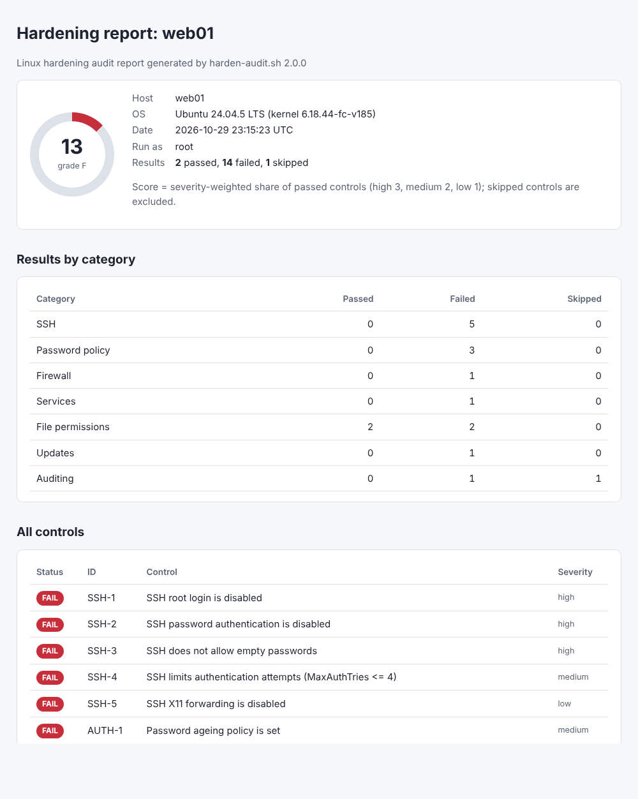
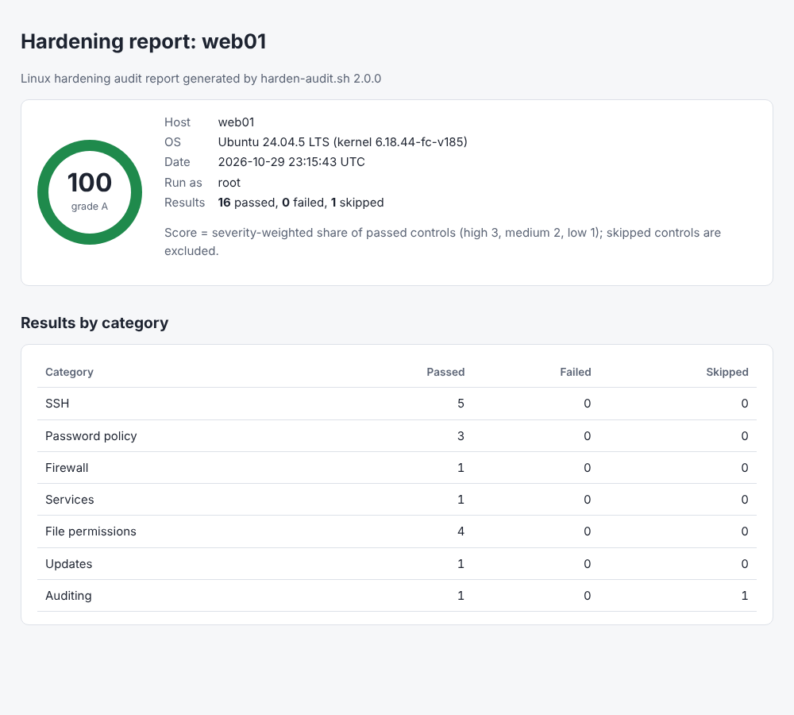

# HLinux: Linux hardening audit and hardening tool

[](https://github.com/yshxrkz/HLinux/actions/workflows/ci.yml)

`harden-audit.sh` checks a Linux server against 17 hardening controls modelled on the
[CIS Benchmarks](https://www.cisecurity.org/cis-benchmarks). It covers SSH configuration,
password policy, the host firewall, unnecessary services, account-file permissions,
automatic updates and auditd. Each control gets **PASS**, **FAIL** or **SKIP**, with an
explanation of what was found, why it matters and how to fix it. The results add up to a
weighted **hardening score** (0 to 100, graded A to F), which you can also export as a
Markdown, HTML or JSON report.

It has two modes:

- **`audit`** is strictly read-only. It never changes the system, and that is verified by
  tracing its system calls in the tests.
- **`harden`** fixes what failed. For every control it first shows the exact plan (commands,
  plus the full content of any file it writes), then applies it **only after you confirm**.
  `--dry-run` shows every plan and changes nothing. Every file is backed up before it is
  touched, and SSH changes are validated with `sshd -t` and rolled back if sshd rejects them.

It is plain Bash with no dependencies beyond what a server already has. It is tested
end-to-end on Ubuntu 24.04 and smoke-tested on Rocky Linux 9.

> [!WARNING]
> **Try `harden` on a virtual machine or a snapshot first, never straight on a server you
> care about.** It changes SSH, PAM, firewall, service and package configuration. It has
> safety checks against locking you out and keeps backups, but a firewall or SSH change can
> still cut off access in ways no script can foresee: a custom port forward, a management
> agent, a second SSH daemon. Start with `audit` and `harden --dry-run`, read the plan, and
> keep a console (not just SSH) open the first time you apply it.



## Contents

- [Quick start: the safe demo](#quick-start-the-safe-demo)
- [Install and usage](#install-and-usage)
- [What it checks, and why](#what-it-checks-and-why)
- [How hardening works](#how-hardening-works)
- [Example output](#example-output)
- [Reports and the hardening score](#reports-and-the-hardening-score)
- [The read-only guarantee](#the-read-only-guarantee)
- [Testing and CI](#testing-and-ci)
- [Project layout](#project-layout)
- [Limitations](#limitations)
- [What I learned](#what-i-learned)

## Quick start: the safe demo

The repository includes a deliberately insecure Ubuntu 24.04 container: root can log in with
a password, an account has no password, `/etc/shadow` is world-readable, an FTP server is
running, and there is no firewall, no automatic updates and no auditd. It is the safe place
to see what the tool does.

```bash
git clone https://github.com/yshxrkz/HLinux.git
cd HLinux
make demo        # or: docker build -t harden-audit-demo . && docker run --rm -it --cap-add NET_ADMIN harden-audit-demo
```

The demo audits the container, hardens it with `--yes`, and audits it again, going from
**13/100 (F)** to **100/100 (A)**. With `make demo`, the reports land in `./reports/`.
To explore by hand instead:

```bash
docker run --rm -it --cap-add NET_ADMIN harden-audit-demo bash
harden-audit audit
harden-audit harden --dry-run
harden-audit harden          # asks before every change
```

`NET_ADMIN` lets ufw load firewall rules inside the container's own network namespace.
The container is insecure on purpose: don't publish its ports or run it on a network you
care about.

## Install and usage

**Requirements:** Linux with Bash 4.4+ and the usual base tools (coreutils, grep, sed, awk).
It uses `sshd`, `systemctl`, `ufw`, `firewall-cmd`, `nft`, `apt-config`/`dpkg-query` or
`rpm` when they are present. Run it as root for complete results. Without root, checks it
cannot perform are reported as SKIP instead of guessed.

```bash
git clone https://github.com/yshxrkz/HLinux.git
cd HLinux
sudo ./harden-audit.sh                                   # audit (the default command)

# optional: install as a command
sudo ln -s "$PWD/harden-audit.sh" /usr/local/bin/harden-audit
```

| Command | What it does |
|---|---|
| `harden-audit.sh [audit]` | Check every control, print PASS/FAIL/SKIP and the score. Read-only. |
| `harden-audit.sh harden` | Fix failing controls, asking before each one. Needs root. |
| `harden-audit.sh list` | List the controls with severity, category and whether they can be fixed automatically. |

| Option | Applies to | Meaning |
|---|---|---|
| `-q`, `--quiet` | audit | Only print FAIL and SKIP results, plus the summary |
| `-r`, `--report FILE` | audit, harden | Also write a report. The format comes from the extension (`.md`, `.html`, `.json`) |
| `--format md\|html\|json` | audit, harden | Report format, if the file name doesn't say |
| `--no-color` | all | No ANSI colours (`NO_COLOR=1` works too) |
| `-n`, `--dry-run` | harden | Show every planned change and change nothing. Works without root. |
| `-y`, `--yes` | harden | Apply every fix without asking (automation, demo) |
| `--only IDS` | harden | Only these controls, e.g. `--only SSH-1,FW-1` |
| `--skip IDS` | harden | Never touch these controls, e.g. `--skip SVC-1` |
| `--force` | harden | Override the SSH lock-out safety checks (see below) |

**Exit status:** `0` means no control failed, `1` means at least one still fails, `2` means
a usage error or a refusal to run (e.g. `harden` without root, or without a terminal and
without `--yes`). A dry run exits `0`.

Typical workflow on a new VM:

```bash
sudo ./harden-audit.sh audit --report before.html     # what's wrong, and why
sudo ./harden-audit.sh harden --dry-run               # exactly what would change
sudo ./harden-audit.sh harden --report after.html     # apply, one confirmation per control
```

In CI or configuration management, the audit exit code works as a gate:
`sudo ./harden-audit.sh audit --quiet --report audit.json || alert-the-team`.

## What it checks, and why

Severity sets each control's weight in the score: high = 3, medium = 2, low = 1.

| ID | Control | Passes when | Severity | Why it matters |
|---|---|---|---|---|
| SSH-1 | SSH root login disabled | `PermitRootLogin no`, and no `Match` block turns it back on | high | Root is the one account every attacker knows exists. Logging in as yourself and using sudo leaves an audit trail, and a leaked root credential alone is no longer enough. |
| SSH-2 | SSH password authentication disabled | `PasswordAuthentication no`, keyboard-interactive is not a password backdoor via PAM, and no `Match` block re-enables passwords | high | Internet-facing SSH sees constant password guessing. Keys can't realistically be brute-forced and aren't affected by password reuse. |
| SSH-3 | No empty passwords over SSH | `PermitEmptyPasswords no` | high | Otherwise any account without a password is a remote shell. |
| SSH-4 | Limited authentication attempts | `MaxAuthTries` ≤ 4 (OpenSSH default: 6) | medium | Slows brute force and makes it stand out in the logs. |
| SSH-5 | X11 forwarding disabled | `X11Forwarding no` (Debian/Ubuntu ship `yes`) | low | A compromised server could reach back into the admin's desktop: keystrokes, screenshots. |
| AUTH-1 | Password ageing policy | `/etc/login.defs`: `PASS_MAX_DAYS` ≤ 365, `PASS_MIN_DAYS` ≥ 1, `PASS_WARN_AGE` ≥ 7 | medium | Limits how long a stolen password stays useful, and stops users cycling straight back to the old one. |
| AUTH-2 | No empty or unshadowed passwords | No empty password field in `/etc/passwd` or `/etc/shadow`, and no hashes in world-readable `/etc/passwd` | high | Empty passwords need no cracking at all; hashes in `/etc/passwd` can be copied by any user and cracked offline. |
| AUTH-3 | Password quality enforced | `pam_pwquality` is in the PAM password stack with `minlen` ≥ 14 | medium | Weak passwords can only be rejected at the moment they are set. |
| FW-1 | Host firewall active | ufw enabled, firewalld running, or an nftables/iptables input chain that drops traffic | high | Default-deny means a service installed or misconfigured later isn't automatically exposed. |
| SVC-1 | No unnecessary services | None of 19 legacy or rarely-needed services is running (telnet, rsh, TFTP, FTP, (x)inetd, NIS, Avahi, CUPS, rpcbind, NFS, Samba, SNMP, ...) | medium | Every listening daemon is attack surface; several of these send passwords in cleartext. |
| FILE-1 | `/etc/passwd` permissions | 644 or stricter, `root:root` | high | Write access means adding a UID 0 account: instant root. |
| FILE-2 | `/etc/shadow` permissions | 640 or stricter, `root:shadow` (Debian) or `root:root` (RHEL) | high | Read access means offline cracking of every password hash. |
| FILE-3 | `/etc/group` permissions | 644 or stricter, `root:root` | medium | Write access means adding yourself to `sudo`, `wheel` or `docker`. |
| FILE-4 | `/etc/gshadow` permissions | 640 or stricter, `root:shadow`/`root:root` | medium | Group password hashes and group administrator lists. |
| UPD-1 | Automatic security updates | `unattended-upgrades` enabled with its timers (Debian/Ubuntu), or `dnf-automatic` set to install (RHEL family) | high | Most real compromises use vulnerabilities that already have a patch. |
| AUD-1 | auditd running | auditd installed, running and enabled at boot (SKIP inside containers, where auditd cannot run) | medium | Records logins, privilege changes and edits to key files in a log users can't alter. |
| AUD-2 | Audit rules configured | Rules watch `/etc/passwd`, `shadow`, `group`, `gshadow`, `sudoers`, `sudoers.d` and `sshd_config` | medium | Answers "who changed this, and when?" after an incident. |

`harden-audit.sh list` prints the same catalogue from the code.

## How hardening works

`harden` runs the audit silently, then walks through the failing controls in order. For each one it:

1. **Shows the plan.** Each fix is written once against small `act_*` helpers (`act_run`,
   `act_write_file`, `act_set_option`, `act_pkg_install`, ...). In plan mode they only print
   what they would do, including the complete content of new files. `--dry-run` is the same
   plan for every control.
2. **Asks.** You answer `[y]es / [n]o / [a]ll remaining / [q]uit`. Without a terminal it
   refuses to run unless you pass `--yes`.
3. **Applies, carefully:**
   - Every file is **copied to `/var/backups/harden-audit/<timestamp>-XXXX/`** (mode 700)
     before it is changed. Files that didn't exist yet are listed in `created-files.txt`.
     Command output and the original permissions go to `harden.log` in the same directory.
   - Files are replaced **atomically**: written to a temp file in the same directory, then
     renamed. Owner and mode are preserved, and SELinux labels are restored where relevant.
   - SSH settings go into `/etc/ssh/sshd_config.d/00-hardening.conf`. sshd uses the *first*
     value it finds, and `00-` sorts first. Without an `Include`, they go at the top of
     `sshd_config`. The change is **validated with `sshd -t` and rolled back** if sshd rejects
     it. If `sshd -t` already fails beforehand, nothing is changed. Then sshd is reloaded.
   - Existing settings are **never loosened**: AUTH-1 only changes the `login.defs` values
     that fail, so `PASS_MAX_DAYS 90` stays 90.
   - A fix that can't finish (e.g. firewalld without systemd) **stops before changing
     anything** and is reported as manual.
4. **Re-audits** and prints each control's before/after status and the score change, and
   writes the report if you asked for one.

### Lock-out safety checks

These fixes are **refused** unless you pass `--force`:

| Fix | Refused when |
|---|---|
| SSH-1 (disable root login) | No non-root user with a login shell is in `sudo`, `wheel` or `admin`, so nobody could become root over SSH afterwards. |
| SSH-2 (disable passwords) | No non-root user has a key in an `AuthorizedKeysFile` (`%h`/`%u` tokens are expanded), **or** you are running it over SSH (`SSH_CONNECTION`) as a user who has no key yourself. |

Also:

- The firewall fix always **allows the SSH port first** (read from the effective sshd config,
  so a custom port is respected) before switching to default-deny.
- `Match` blocks that override a setting are reported for manual review, never edited
  automatically.
- SVC-1 can't know whether a host is *meant* to be, say, a DNS server. Its plan says so:
  decline it, or use `--skip SVC-1`.

### Undoing a change

There is no automatic rollback command (yet). Everything needed to undo a run is in its backup directory:

```bash
ls /var/backups/harden-audit/                                   # one directory per run
sudo cp -a /var/backups/harden-audit/<run>/etc/login.defs /etc/login.defs     # restore a file
xargs -d '\n' sudo rm -f -- < /var/backups/harden-audit/<run>/created-files.txt   # remove files it created
less /var/backups/harden-audit/<run>/harden.log                 # every command, original permissions
```

Packages it installed (e.g. `ufw`, `auditd`) and services it disabled are listed in
`harden.log`. Remove or re-enable them with your package manager and `systemctl`.

## Example output

All of this is real output from the demo container. The full reports are in
[`docs/`](docs/): [Markdown before](docs/example-report-before.md),
[Markdown after](docs/example-report-after.md), and HTML
[before](docs/example-report-before.html) and [after](docs/example-report-after.html)
(download to view).

**Audit (excerpt):**

```text
$ sudo harden-audit audit
Linux hardening audit (harden-audit.sh 2.0.0)
Host:   web01
OS:     Ubuntu 24.04.5 LTS (kernel 6.18.44-fc-v185)
Date:   2026-10-29 23:14:29 UTC
User:   root

== 1. SSH server ==
[FAIL] SSH-1   SSH root login is disabled
        Detail: PermitRootLogin is 'yes' (effective config from 'sshd -T'). Root can log in directly, including with a password.
        Fix:    Add 'PermitRootLogin no' to /etc/ssh/sshd_config.d/00-hardening.conf (drop-ins are read first, and sshd uses the FIRST value it finds).
                Log in as a normal user and use sudo instead. Then: sudo sshd -t && sudo systemctl reload ssh
[FAIL] SSH-2   SSH password authentication is disabled
        Detail: PasswordAuthentication is 'yes' (effective config from 'sshd -T').
                Passwords can be brute-forced; SSH keys cannot realistically be guessed.
        Fix:    First make sure every admin can log in with an SSH key (ssh-copy-id user@host)!
                Then add 'PasswordAuthentication no' and 'KbdInteractiveAuthentication no' to /etc/ssh/sshd_config.d/00-hardening.conf (drop-ins are read first, and sshd uses the FIRST value it finds).
                Then: sudo sshd -t && sudo systemctl reload ssh
...
== 5. Account file permissions ==
[PASS] FILE-1  /etc/passwd permissions are 644 or stricter, owned by root:root
        Detail: /etc/passwd is mode 644, owned by root:root.
[FAIL] FILE-2  /etc/shadow permissions are 640 or stricter, owned by root:root/shadow
        Detail: mode is 644, which grants more than 640. /etc/shadow contains password hashes; if other users can read it they can crack them offline.
        Fix:    sudo chown root:shadow /etc/shadow && sudo chmod 0640 /etc/shadow
...
== 7. Auditing (auditd) ==
[SKIP] AUD-1   auditd is installed and running
        Detail: This is a container. auditd needs the host kernel's audit subsystem and cannot run inside a container; the host should run it.
        Fix:    Run this audit on the container host (or a VM) to check auditd.
...
== Summary ==
2 passed, 14 failed, 1 skipped (17 checks)
Hardening score: 13/100 (grade F) [##------------------]
```

**Dry run (excerpt):**

```text
$ sudo harden-audit harden --dry-run --only SSH-1,SSH-2,FW-1
Linux hardening - DRY RUN (nothing will be changed) (harden-audit.sh 2.0.0)
...
SSH-1 SSH root login is disabled (high)
  PermitRootLogin is 'yes' (effective config from 'sshd -T'). Root can log in directly, including with a password.
    [note]  admin users who can still use sudo: ubuntu admin
    [plan]  set 'PermitRootLogin no' in /etc/ssh/sshd_config.d/00-hardening.conf (currently: unset)
    [plan]  sshd -t   (validate; the change is rolled back if this fails)
    [plan]  kill -HUP 9

FW-1 A host firewall is active (high)
  No active firewall found (checked ufw, firewalld, nftables and iptables). Notes: ufw is installed but not enabled. Every listening service is reachable from the network.
    [note]  already installed: ufw
    [plan]  ufw allow 22/tcp comment 'SSH (harden-audit.sh)'
    [plan]  ufw default deny incoming
    [plan]  ufw default allow outgoing
    [plan]  ufw --force enable
    [note]  only SSH (port 22) is allowed in. Open anything else this host serves with: ufw allow PORT/tcp

== Result ==
Dry run: nothing was changed. 3 fix(es) planned, 0 need manual work, 0 refused by a safety check.
```

**Harden (end of the run):**

```text
== Result ==
  SSH-1   FAIL -> PASS
  SSH-2   FAIL -> PASS
  ...
  UPD-1   FAIL -> PASS
  AUD-2   FAIL -> PASS
Applied 14, failed 0, declined 0, manual 0, refused 0.
Hardening score: 13/100 (grade F) -> 100/100 (grade A)
Backups and command log: /var/backups/harden-audit/20261029-231523-4r9R
```

**A refused fix** (the admin's SSH key removed first):

```text
SSH-2 SSH password authentication is disabled (high)
  PasswordAuthentication is 'yes' (effective config from 'sshd -T').
  Passwords can be brute-forced; SSH keys cannot realistically be guessed.
    [refuse] no non-root user has an SSH key in an authorized_keys file, so nobody could log in after passwords are disabled. Add one with: ssh-copy-id user@host
    [refuse] Fix that first, or re-run with --force if you are sure you will not lose access.
```

## Reports and the hardening score

`--report FILE` writes one of three formats:

- **HTML:** a single self-contained file (inline CSS, no JavaScript, no external resources,
  light and dark themes) with a score ring, per-category table, every control, and a card
  per finding showing what was found, why it matters and how to fix it.
- **Markdown:** the same content, which renders well on GitHub and in a CI job summary.
- **JSON:** machine-readable: score, grade, summary counts, and every control with its
  status, detail, fix and rationale. After `harden` it also includes `score_before` and the
  outcome of each fix.

Reports are created with **mode 600** (they name accounts and weaknesses). They are written
through a temp file in the target directory and then renamed, so a symlink planted at the
report path is replaced, not followed.

**Score** = severity-weighted share of evaluated controls that pass:
`round(100 × Σweight(PASS) / Σweight(PASS + FAIL))` with high = 3, medium = 2, low = 1.
SKIPs are left out, so a non-root run isn't penalised for checks it couldn't make. Grades:
A ≥ 90, B ≥ 80, C ≥ 70, D ≥ 60, F below.



## The read-only guarantee

The `audit` and `list` commands and `harden --dry-run` are built so they cannot modify the host:

- They only read files and run inspection commands (`stat`, `sshd -T`, `systemctl
  is-active`/`is-enabled`/`list-units`, `nft list ruleset`, `iptables -S`, `auditctl -l`,
  `apt-config dump`, `dpkg-query`, `rpm -q`).
- They write **no files**, apart from a report you explicitly ask for. That includes temp
  files: bash here-strings and here-docs can create those, so the tool doesn't use them.
- They do **not** call `ufw status`, which writes `/run/ufw.lock`. They read
  `/etc/ufw/ufw.conf` instead.
- They only query netfilter (`nft`, `iptables`) when the kernel module is already loaded,
  so an audit can never trigger a module load.
- `/etc/shadow` is read only to look for *empty* password fields. Hashes are never printed.

This is **tested, not just intended**. The host tests run the audit and the dry run under
`strace`, and fail on any open-for-write or other mutating system call. With `--report`, the
only writes allowed are inside the report's directory. That test is how the `ufw.lock` write
was found.

## Testing and CI

| Suite | Where it runs | What it proves |
|---|---|---|
| `tests/run-tests.sh` (`sudo make test`) | the host, read-only | 60+ scenario checks (a few depend on the host, e.g. the process-based service check only runs without systemd). Fixture files (`sshd_config`, `/etc/shadow`, `login.defs`, PAM, apt config, ...) are bind-mounted over the real ones **inside a private mount namespace** (`unshare -m`), so the real system is never touched. Covers secure/insecure configs, `Match` overrides, non-root behaviour, all report formats, the harden safety rails, and the `strace` read-only proof. |
| `tests/container-tests.sh` via `tests/docker-test.sh` (`make test-docker`) | the insecure Ubuntu demo container | 63 end-to-end checks: every expected FAIL, that dry runs, refusals and declined prompts change nothing (fingerprint of `/etc`, modes, services, backups), full hardening, then **proof from the outside**: key login still works, password and root logins are rejected over real SSH, the empty-password account is locked, ufw is active, vsftpd is stopped, packages and rules are in place, backups exist, and a second run is a no-op. |
| `tests/rocky-smoke.sh` (`make test-rocky`) | a Rocky Linux 9 container | The RHEL-family paths: dnf, `system-auth`, RHEL-style `/etc/shadow` (`0000 root:root`), and fixes that need systemd stopping cleanly without it. |

[GitHub Actions](.github/workflows/ci.yml) runs on every push to `main` and every pull request:

- **Lint:** [ShellCheck](https://www.shellcheck.net/) on every shell file, hadolint on the
  Dockerfile, actionlint on the workflow.
- **Host tests** on the Ubuntu 24.04 runner, plus a real read-only audit and dry run of the
  runner VM (which, unlike the containers, runs systemd), uploaded as an artifact.
- **Container tests:** builds the demo image and runs the end-to-end suite. The hardened
  report is added to the job summary and all reports are uploaded as artifacts.
- **RHEL-family smoke test** in Rocky Linux 9.

The workflow runs with read-only repository permissions and doesn't persist checkout
credentials. There is no CodeQL job because the project is pure Bash, which CodeQL doesn't
analyse; ShellCheck is the static analysis here.

## Project layout

```text
harden-audit.sh          CLI: argument parsing, audit/harden/list commands, header and summary
lib/common.sh            output, control registry, result recording, score, OS/container detection
lib/report.sh            Markdown / HTML / JSON report writers
lib/harden.sh            harden engine: plan vs apply, act_* helpers, backups, prompts
lib/controls/*.sh        one file per category: register_control, check_*, fix_*
Dockerfile, docker/      the deliberately insecure Ubuntu demo container
tests/                   host scenario tests, container end-to-end tests, Rocky smoke test
docs/                    example reports and screenshots
```

Adding a control means calling `register_control ID SEVERITY CATEGORY FIX_FUNCTION TITLE WHY`,
writing a `check_*` function that calls `report PASS|FAIL|SKIP`, and optionally a `fix_*`
function built from the `act_*` helpers, so it automatically gets a dry run, a confirmation
prompt, backups and logging.

## Limitations

- This is a **focused** set of 17 high-value controls, not a full CIS assessment (the
  Ubuntu benchmark has hundreds). For compliance work, use OpenSCAP, CIS-CAT or Lynis.
- **Debian/Ubuntu** are the primary target (end-to-end tested). The **RHEL family** is
  smoke-tested in a container without systemd, so its systemd-dependent fixes (firewalld,
  dnf-automatic timers) haven't run in CI. Other distributions get the audit, with SKIP
  where a check is distribution-specific.
- Firewall detection confirms that a firewall is active and drops traffic, not that its
  rules are sensible. Review them yourself (`ufw status verbose`, `firewall-cmd --list-all`,
  `nft list ruleset`).
- Password ageing (AUTH-1) follows the classic CIS recommendation. Current NIST guidance
  (SP 800-63B) advises against forced periodic changes. Use `--skip AUTH-1` if your policy
  follows NIST.
- auditd cannot run inside containers, so AUD-1 is SKIP there. Audit the container host.
- There is no automatic rollback command yet. See [Undoing a change](#undoing-a-change).

## What I learned

- **"Read-only" has to be proven, not promised.** I assumed an audit that only "looks"
  couldn't change anything. Tracing it with `strace` showed `ufw status` writing a lock
  file. Bash here-strings can create temp files, and querying iptables can load kernel
  modules. Now the test suite fails on any write.
- **sshd's configuration rules are subtle.** The *first* value wins, drop-ins are read
  wherever the `Include` line sits, and `Match` blocks can quietly re-enable root or password
  logins for some connections. Asking `sshd -T` for the effective config beats parsing the
  files, but I still needed a parser for non-root runs.
- **Safe automation is mostly about the unhappy paths.** Show the plan, ask, back up, write
  atomically, validate (`sshd -t`), roll back, and refuse when a change could lock someone
  out. Two things surprised me: never loosening a stricter existing value, and never starting
  a fix that can't finish (e.g. firewalld without systemd).
- **Bash has sharp edges.** Since Bash 5.2, an unquoted `&` in `${var//pattern/replacement}`
  means "the matched text", so my HTML escaping turned `<` into `<lt;`. I only found it
  because a test parses the generated HTML. A timestamped backup directory also collided when
  two runs started in the same second; `mktemp -d` fixed that.
- **Writing files as root is a security decision.** Reports are mode 600, and both reports
  and config files go through a temp file and `rename`, so a planted symlink can't redirect
  a root-owned write.
- **Containers aren't small VMs.** No systemd, no auditd, often no IPv6 (vsftpd wouldn't
  start until I set `listen_ipv6=NO`), and ufw needs `NET_ADMIN`. Testing against fixtures in
  a private mount namespace let me cover dangerous scenarios without ever touching the real
  system.
